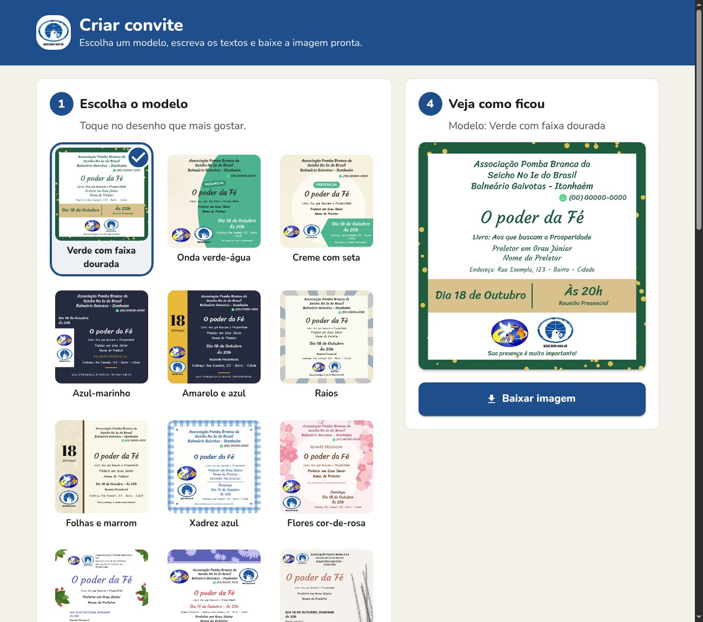
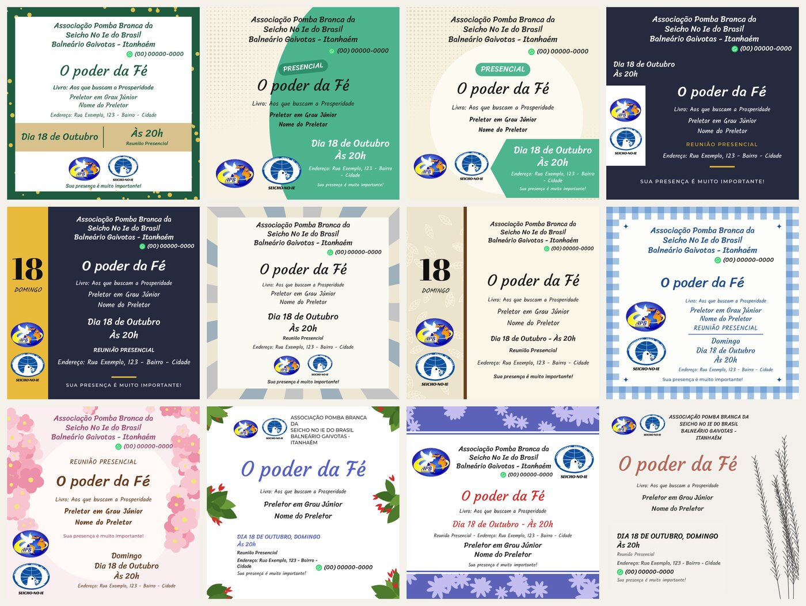

# Criar Convite — Seicho-No-Ie

Site para montar os convites das reuniões da Seicho-No-Ie a partir de modelos prontos.
A pessoa escolhe um modelo, escreve os textos, marca os logos e baixa a imagem pronta
(PNG de **1654 × 1654 px**) ou envia direto pelo WhatsApp.

O público principal são **pessoas de idade**, e toda decisão do projeto parte disso:
letras grandes, poucos passos, nada para configurar e nenhum jeito de "quebrar" o convite.



### Modelos disponíveis



## Funcionalidades

- **12 modelos** inspirados nas artes já usadas pelos núcleos.
- **Prévia ao vivo:** o convite e as miniaturas mudam enquanto a pessoa digita.
- **Texto que se ajusta sozinho:** campo vazio some sem deixar buraco, e texto longo diminui até caber.
- **Tudo fica salvo** no navegador. As informações do núcleo (quem convida, WhatsApp, endereço, mensagem)
  não precisam ser digitadas de novo. "Começar convite novo" apaga só tema, livro, preletor e data.
- **Data pelo calendário:** o dia da semana e o "Dia 18 de Outubro" são gerados automaticamente.
- **Logos selecionáveis:** Pomba Branca (APB), Seicho-No-Ie e Emblema SNI.
- **Enviar pelo WhatsApp** nos celulares que permitem compartilhar arquivos (Web Share API).
- **Sem servidor:** é um site estático; nenhum dado sai do aparelho de quem usa.

## Tecnologias

- [React 18](https://react.dev) + [Vite 5](https://vitejs.dev)
- [MUI (Material UI) v5](https://mui.com) para a interface
- `<canvas>` 2D para desenhar os convites (sem bibliotecas de imagem)
- Fontes do [Google Fonts](https://fonts.google.com): Courgette, Sriracha, Kalam, Abril Fatface, Montserrat e Nunito

## Como rodar

Requisitos: Node.js 18 ou mais recente.

```bash
npm install
npm run dev       # ambiente de desenvolvimento
npm run build     # gera o site final em dist/
npm run preview   # serve o dist/ localmente para conferir o build
```

A pasta `dist/` pode ser publicada em qualquer hospedagem estática
(GitHub Pages, Netlify, Vercel). O `vite.config.js` usa `base: './'`, então funciona em subpastas.

### Endereço do site e prévia do link

Quando alguém compartilha o link, o WhatsApp e as redes sociais mostram título, descrição e a imagem
`public/og-image.jpg` (1200 × 630). Essas tags precisam do endereço completo do site, definido em `.env`:

```bash
VITE_SITE_URL=https://banners-sni.vercel.app/
```

Se publicar em outro endereço (um fork, um domínio próprio), troque esse valor **com a barra no final**
e gere o build de novo. Para conferir a prévia depois de publicado, use o
[Facebook Sharing Debugger](https://developers.facebook.com/tools/debug/), que também força a atualização
do cache. O WhatsApp usa as mesmas tags.

## Estrutura

```
docs/                    imagens usadas neste README
public/logos/            logos disponíveis para os convites
public/og-image.jpg      imagem da prévia ao compartilhar o link
src/
  main.jsx               ponto de entrada (tema MUI)
  theme.js               tema: fontes e botões grandes
  App.jsx                página: os 4 passos, baixar e compartilhar
  components/
    Step.jsx             cartão numerado de cada passo
    ModelPicker.jsx      grade de miniaturas dos modelos
    TextForm.jsx         formulário de textos
    LogoPicker.jsx       seleção dos logos
    BannerCanvas.jsx     canvas que desenha um convite
  banner/
    data.js              valores padrão, salvamento e formatação dos textos
    draw.js              motor de layout e enfeites (flores, folhas, pontos...)
    templates.js         os modelos de convite
    render.js            lista de logos, carregamento de fontes/logos e exportação
```

## Como os modelos funcionam

Todo modelo é uma função que desenha num quadro de **1080 × 1080 unidades**. Na hora de exportar,
o desenho é ampliado para 1654 px, então nenhuma coordenada depende do tamanho final.

```js
function meuModelo(ctx, t, imgs) { /* ... */ }
```

| Parâmetro | O que é |
|-----------|---------|
| `ctx`  | contexto 2D do canvas, já na escala de 1080 |
| `t`    | textos prontos para desenhar (veja abaixo) |
| `imgs` | logos marcados pela pessoa, já carregados (pode ser uma lista vazia) |

Campos de `t` (gerados por `toBannerText` em `src/banner/data.js`). Qualquer um pode vir vazio:

| Campo | Exemplo |
|-------|---------|
| `convite` | "Associação Pomba Branca da\nSeicho No Ie do Brasil..." (respeita as quebras de linha) |
| `whatsapp` | "(00) 00000-0000" |
| `tema` | "O poder da Fé" |
| `livro` | "Livro: Aos que buscam a Prosperidade" |
| `cargo` / `preletor` | "Preletor em Grau Júnior" / "Nome do Preletor" |
| `dataLonga` | "Dia 18 de Outubro" |
| `diaNumero` | "18" |
| `diaSemana` / `diaSemanaCurto` | "Segunda-feira" / "Segunda" |
| `horario` | "Às 20h" (ou o texto livre digitado, como "Das 8h30 às 11h") |
| `tipo` / `tipoCurto` | "Reunião Presencial" / "Presencial" |
| `endereco` | "Endereço: ..." (vazio quando a reunião é virtual) |
| `mensagem` | "Sua presença é muito importante!" |

### O motor de layout: `flow`

Em vez de posicionar cada texto à mão, empilhe os itens dentro de uma caixa com `flow`.
Ele esconde os itens vazios e, se o conteúdo não couber, **diminui tudo junto**. Os textos pequenos
têm um tamanho mínimo legível, então quem encolhe primeiro são os textos grandes.

```js
flow(ctx, { x: 90, y: 80, w: 900, h: 550 }, [
  text(t.tema, { font: FONTS.script, size: 84, color: '#1e5b3f' }),
  text(t.livro, { font: FONTS.body, size: 36 }),
  whatsapp(t.whatsapp, { font: FONTS.hand, size: 34, align: 'right' }),
  line({ color: '#e8b83a', width: 140, thickness: 8 }),
  logos(imgs, { size: 150 }),
], { align: 'center', valign: 'center', gap: 18, spread: 14 });
```

**Itens disponíveis**

| Item | Opções |
|------|--------|
| `text(valor, opts)` | `font`, `size`, `color`, `weight`, `italic`, `upper`, `spacing` (entre letras, em em), `lineHeight`, `align`, `gap` |
| `whatsapp(valor, opts)` | texto com o ícone do WhatsApp; aceita as mesmas opções de fonte |
| `pill(valor, opts)` | etiqueta arredondada; `background`, `rotate` (graus) |
| `line(opts)` | traço decorativo; `width`, `thickness`, `color` |
| `logos(imgs, opts)` | fileira de logos; `size` (altura) |

**Opções do `flow`:** `align` (`left` \| `center` \| `right`), `valign` (`top` \| `center` \| `bottom`),
`gap` (espaço padrão entre itens) e `spread` (quanto do espaço que sobra pode virar respiro entre itens, em px).

**Outros auxiliares em `draw.js`**

- `drawLogos(ctx, imgs, caixa, { direction: 'row' | 'column', align, gap })`: logos fora do fluxo, como numa coluna lateral.
- Formas e enfeites: `fillRect`, `roundRect`, `dots`, `halftone`, `flower`, `leaf`, `leafOutline`, `sparkle`.
- `seeded(semente)`: números aleatórios **sempre iguais**. Use-o em vez de `Math.random()`
  para o enfeite não mudar a cada letra digitada.
- `FONTS`: `script` (Courgette), `hand` (Sriracha), `body` (Kalam), `serif` (Abril Fatface), `sans` (Montserrat).

## Como contribuir

Contribuições são bem-vindas: modelos novos, correções, melhorias de acessibilidade ou de texto.

1. Faça um fork e crie um branch: `git checkout -b modelo-girassol`.
2. Faça a alteração e confira no navegador (`npm run dev`).
3. Garanta que o build passa: `npm run build`.
4. Abra um Pull Request descrevendo o que mudou, **com uma imagem do resultado** quando mexer em modelos ou na tela.

### Adicionar um modelo novo

1. Em `src/banner/templates.js`, crie a função do modelo (use os existentes como ponto de partida).
2. Registre em `TEMPLATES` com um `id` único (sem espaços nem acentos) e um `nome` simples, que descreva o visual:

   ```js
   { id: 'girassol', nome: 'Girassóis', draw: girassol },
   ```

3. Teste o modelo nestes cenários antes de abrir o PR:
   - todos os campos preenchidos;
   - tema e nome do preletor **bem longos**;
   - livro e endereço vazios, e a reunião como **virtual**;
   - **nenhum** logo, **um** logo e os **três** logos;
   - a miniatura também precisa ficar reconhecível.

4. Se puder, atualize o mosaico `docs/modelos.jpg` com o modelo novo.

### Adicionar um logo

1. Coloque o PNG (fundo transparente, sem margens sobrando) em `public/logos/`.
2. Registre em `LOGOS` (`src/banner/render.js`) e em `DEFAULT_DATA.logos` (`src/banner/data.js`).

### Adicionar uma fonte

1. Inclua a família no link do Google Fonts em `index.html`.
2. Adicione em `FONTS` (`src/banner/draw.js`). Ela é carregada antes do primeiro desenho.
3. Confira se a fonte tem **acentos do português** (ã, ç, é, ô...).

### Diretrizes

- **Pense em quem vai usar.** Texto da interface em português simples, letra grande e botões grandes.
  Nada de jargão ("upload", "template", "exportar"); prefira "modelo", "baixar", "enviar".
- **Nada de servidor nem login.** O site deve continuar 100% estático.
- **Evite dependências novas.** Se for mesmo necessária, explique o motivo no PR.
- **Não coloque dados reais** (telefones, endereços, nomes de pessoas) nos valores padrão ou nos exemplos.
- **Mantenha o padrão do código:** componentes MUI com a prop `sx`, comentários curtos em português
  explicando o *porquê*, e nomes de variáveis descritivos.

## Privacidade

Os textos digitados ficam salvos apenas no navegador de quem usa (`localStorage`) e nunca são enviados
para nenhum servidor. As fontes são carregadas do Google Fonts, então é preciso estar conectado à internet.
